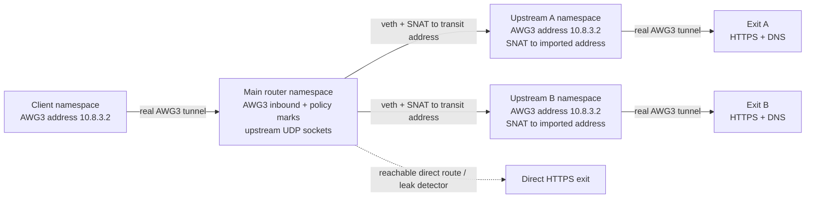

# Upstream namespace proof

This is an isolated feasibility experiment, not an application feature or a production migration. It uses the pinned AWG3 runtime, the existing Go health probe, and the existing `FailoverState` selector. The application, UI, Compose deployment, and production servers are not modified by the experiment.

The same fixtures now support an integration mode that exercises the implemented
`RoutingManager`, namespace lifecycle, and real monitor rounds:

```sh
bash server/test/namespace-proof/run.sh IMAGE_TAG /tests/namespace-routing.test.js
```

`production.js` replaces the prototype routing with application calls. It covers
duplicate `/32` and `/24` profiles, transit-subnet conflicts, policy routes,
connection persistence, real transport outages, fixed-port rollback, failed-import
cleanup, namespace-holder crashes, persisted-state reload, and vanished veth links.
The application monitor rounds are driven explicitly for deterministic timing;
the live API suite separately tests the scheduler. The older default proof mode
remains available for reproducing the original experiment below.

## Run

From the repository root:

```sh
bash server/test/namespace-proof/run.sh awg-chain-easy:upstream-priority-test
```

The image must already contain `/app/failover.js`, `awg-chain-probe`, the AWG tools, Node, `unshare`, and `nsenter`. Docker and OpenSSL are required on the test host. The runner creates an ephemeral test certificate and container, streams the results, propagates the test exit status, and removes both afterward. Certificate validation remains enabled. No production profiles or credentials are used.

The container has `--network none`, no published ports, no Docker socket, and no application state mount. Only the test directory and temporary test PKI are mounted read-only. It needs `NET_ADMIN`, `SYS_ADMIN`, and `/dev/net/tun`; full privileged mode and unconfined security profiles are not used. Its actual host PID, start time, command, and port bindings are recorded when it starts.

## Topology



Each upstream `amneziawg-go` process is created in the router namespace. Its TUN interface is then moved to a separate PID-held network namespace. The process and encrypted UDP socket remain in the router namespace. Management through the existing UAPI socket continues to work, including handshakes and listen-port queries.

Two NAT boundaries are intentional. Before entering an upstream namespace, client source addresses become the router-side transit address. Inside that namespace, they become the original imported address. Returning traffic therefore targets the transit address before crossing back to the router, where the original client destination is restored. This avoids the upstream namespace treating the client's duplicated `10.8.3.2` as its own local destination.

Each main-namespace upstream policy table has both an active unicast default route and a permanent lower-preference `prohibit default`. If the veth disappears, the remaining prohibit route prevents falling through to the working direct route.

## Verified results

On 2026-11-06 UTC, the suite passed all eight scenarios (nine TAP tests including the parent) in about 29 seconds against image `sha256:7ff2045329129439d0dd9498a3b9d6416dc5baea25d74d672d6a303826e09d71`:

1. A real AWG3 downstream client reaches the direct HTTPS service; the leak counter detects that control request and is then reset.
2. Both upstream TUN interfaces move into their namespaces while their UDP processes stay in the router namespace. The remote exits initiate both connections without prior outbound client traffic.
3. The downstream client and both upstreams simultaneously use `10.8.3.2`. Both exits receive real client HTTPS traffic with the expected source address. The production Go helper performs DNS and certificate-verified HTTPS inside each upstream namespace.
4. Switching the default sends new flows through B while an established HTTPS stream continues through A using its connection mark.
5. Dropping encrypted upstream UDP traffic causes real probe failures and priority-based failover. Losing both exits blocks new traffic. Restoring transport restores connectivity and the preferred exit without changing tunnel configuration.
6. An administrative down/up cycle removes the upstream namespace's default route. The probe correctly fails until the route is reinstalled, then forwarding recovers.
7. Restarting the upstream AWG process preserves profile bytes and UDP port `54323`. The remote peer initiates a fresh connection and client HTTPS recovers; the test observed roughly 15 seconds for this recovery.
8. Removing the selected veth leaves the prohibit route effective. The client cannot reach the otherwise working direct exit.

The direct-leak counter stayed at zero throughout the VPN and failure scenarios. Cleanup asserted that all owned child processes exited, only loopback remained in the container, and temporary tunnel keys were removed. The runner then removed the container and temporary PKI.

## Limits and integration requirements

- This proves the packet path and lifecycle technique, not an integrated `RoutingManager` implementation. Namespace creation, startup, shutdown, rollback, address validation, transit allocation, and route reconciliation still need application integration.
- Both imported addresses are `/32` in this experiment. Other prefixes, conflicting transit ranges, and additional upstream counts need integration coverage.
- Upstream UDP sockets still share the main namespace. Fixed listen ports must remain distinct (`54323` and `54324` in this proof). This design solves address overlap; it does not allow duplicate fixed UDP listeners in that namespace.
- Fresh namespaces in this environment have IPv4 forwarding enabled. The proof asserts that prerequisite. Docker's read-only `/proc/sys` prevents normal sysctl writes; production integration must provide or validate forwarding without silently broadening container privileges. This proof did not disable AppArmor, seccomp, or system-path protections.
- PID-held namespaces avoid the bind mounts needed by `ip netns add`. Holders, AWG processes, and veths need explicit supervised cleanup. A namespace must not disappear while its daemon still owns the moved TUN file descriptor.
- The reverse-initiation tests use isolated veth WAN links. Actual Docker port publication, host/provider firewall behavior, container recreation, long rekey periods, and throughput were not exercised.
- The suite uses the real selector with one-sample thresholds for speed, but it orchestrates observations itself. The production monitor scheduler and API mutation queue are not exercised here.
- Test HTTPS and DNS services run in isolated exit namespaces. This is not an external Internet or public-PKI reachability test, and it does not change the application's separate client DNS proxy behavior.
- Existing client profiles and upstream profile contents can remain unchanged when this design is integrated; metadata/runtime migration still needs its own tests before deployment.
